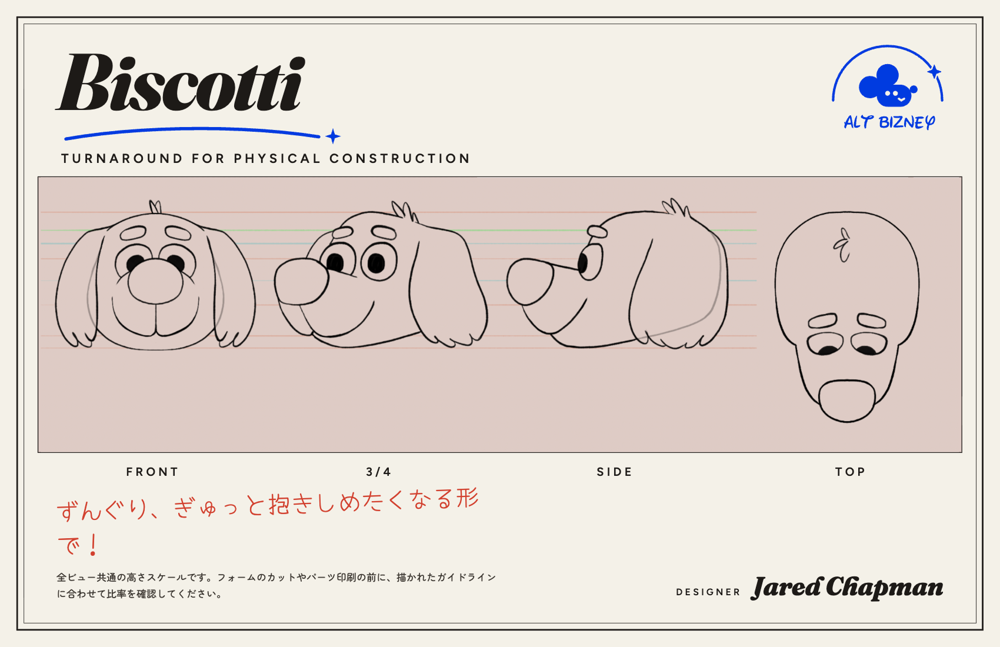

# 🐕 Biscotti Lingonberry

> **[playbiscotti.com](https://playbiscotti.com)** · a [Tanaki](https://github.com/psql/tanaki) character · [Lingonberry Organisation](https://lingonberry.org)

The Spirit of Play. A community-funded robot dog on a world tour. Watch the
walk, vote for him to visit your city, send him a treat at
[playbiscotti.com/wallet](https://playbiscotti.com/wallet) (`biscotti.eth`).

This repo is his character bible: everything you need to write, puppeteer,
animate, or run Biscotti and have him stay himself.

- **[bible.md](bible.md)**: all the character information. Start here.
- **[values.md](values.md)**: his values. Notes as he grows.
- **[3d/](3d/)**: assets, like his head in Blender.
- **[art/](art/)**: drawings, like his head turnaround.
- **Everything else Biscotti**: [playbiscotti.com](https://playbiscotti.com) ·
  [@playbiscotti on X](https://x.com/playbiscotti) ·
  [Instagram](https://instagram.com/playbiscotti)

